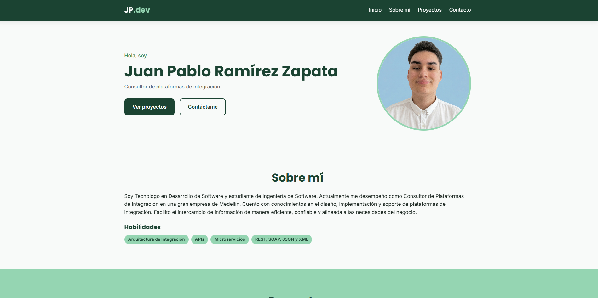
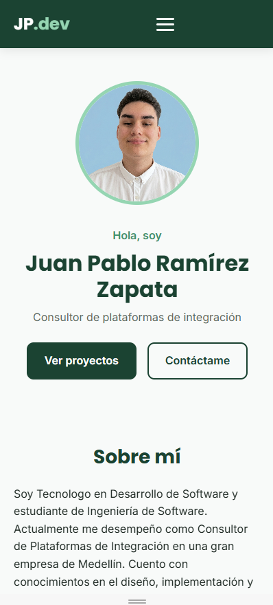

# Mi Portafolio Web Interactivo
Portafolio personal de **Juan Pablo Ramírez Zapata**, desarrollado como actividad integradora
de la Unidad 1 del curso de Programación Web (metodología CDIO).

- **Sitio en línea:** https://www.linkedin.com/in/juan-pablo-ramirez-zapata-9481a3285/
- **Pagina Web:** https://pablormrz.github.io/mi-portafolio/
- **Documento de diseño:** [Documento de diseño en Google Docs](https://docs.google.com/document/d/1Db6niHLuGTepQMyBEqw4hXObEcsF-nmhDrLEhZR6L04/edit?tab=t.0)

## Descripción

Sitio web responsivo que presenta mi perfil, mis proyectos (cargados dinámicamente con
JavaScript) y un formulario de contacto con validación en tiempo real (envío simulado).
## Tecnologías utilizadas
- HTML5 semántico
- CSS3 (Flexbox, CSS Grid, variables CSS, media queries, transiciones)
- JavaScript vanilla (manipulación del DOM, eventos, IntersectionObserver)
- Git y GitHub Pages
## Estructura del proyecto
```
mi-portafolio/
├── index.html
├── css/ (reset, variables, layout, components)
├── js/ (main, form-handler, animations)
├── assets/ (images, icons)
└── README.md
```
## Instalación y ejecución local
1. Clonar el repositorio:
 `git clone https://github.com/pablormrz/mi-portafolio.git`
2. Entrar a la carpeta: `cd mi-portafolio`
3. Abrir `index.html` en el navegador, o en VS Code usar la extensión **Live Server**
 (clic derecho sobre index.html > Open with Live Server).
No requiere instalar dependencias.
## Capturas de pantalla
### Escritorio

### Móvil

## Autor
**Juan Pablo Ramírez Zapata** – [GitHub](https://github.com/pablormrz)
## Licencia
Este proyecto está bajo la licencia MIT. Puedes usarlo y modificarlo citando al autor.